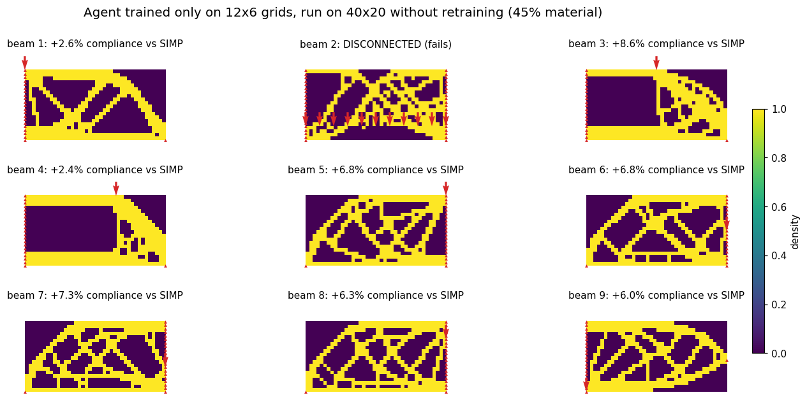
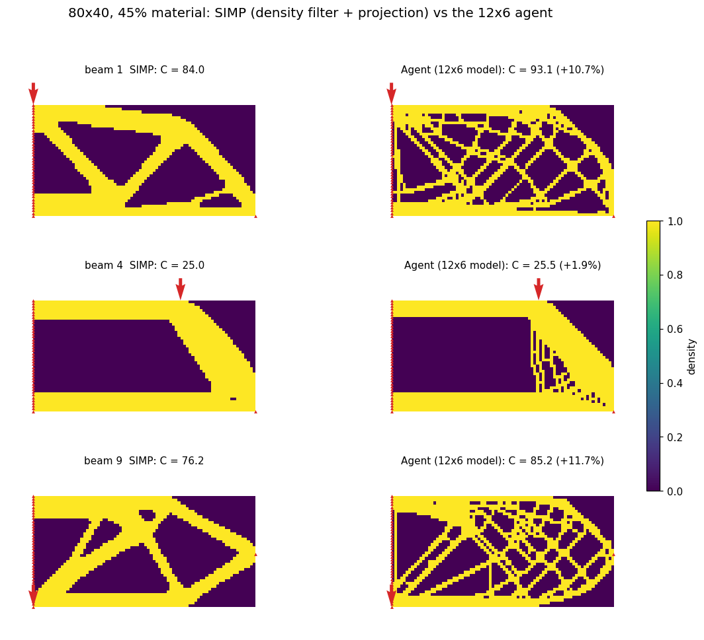

# Structural Optimization with Fully Convolutional PPO

A PPO agent places material on a 2D grid to minimize structural compliance at a
fixed volume. A finite-element solver scores every design. The network is fully
convolutional, so one set of weights works on any grid size and target volume.

## Results: trained on 12x6, run on grids up to 80x40

The agent below was trained only on random 12x6 problems (72 cells, 500k
vector steps, about 2 hours on a laptop GPU). The same weights were then run,
with no retraining or fine-tuning, on the nine built-in beams at 40x20
(800 cells) and 80x40 (3,200 cells). Purple is void, yellow is solid, red
triangles are supports and red arrows are loads. Every design uses exactly 45%
material and is scored by the same finite-element solver. The reference is
classical SIMP with a density filter and Heaviside projection (`src/utils/simp.py`,
best of filter radii 1.5, 2 and 3, thresholded to the same number of solid
cells).





Why it transfers: the network has no layer tied to grid size. Convolutions
build a feature vector for every cell from its neighbourhood, a 1x1
convolution turns each one into "void" and "solid" scores, and the solver
re-computes the strain-energy field after every action, so the global load
path is part of each cell's input. The rule the agent learns is local, and it
applies at any size.

On all 59 problems at 80x40 (9 fixed beams plus 50 random ones), the agent's
designs are a median 6.4% less stiff than SIMP, are within 10% on 48 of 59,
and never disconnect. A second training seed gives a median of 7.3% and 43 of
59 within 10%, so the result repeats. Limits:

- It never beats SIMP at 80x40, and it is slower: about 100 s per design
  against 20 s for SIMP, because it places one cell per step and re-solves
  the structure each time (4,800 steps at 80x40).
- It keeps the member thickness it learned on 12x6 in cells, so on large
  grids it builds lattices of thin members where SIMP uses a few thick ones.
- At 40x20, beam 2 (distributed load, supports on both sides) comes out
  disconnected; the same beam works at 80x40 (+16%).

Details, data and the scripts that produced these figures are in
[`benchmarks/README.md`](benchmarks/README.md) and `scripts/`.

| File | Role |
| --- | --- |
| `src/env/mbb_cnn.py` | Gymnasium environment, reward and observation |
| `src/env/domains.py` | Random support/load problems |
| `src/models/ppo_cnn.py` | Actor-critic networks and PPO |
| `src/utils/fem_fast.py` | Banded Cholesky solver used by the environment |
| `src/utils/fem.py` | Reference solver with gradients, and the MMA optimizer |
| `src/utils/simp.py` | Classical SIMP with density filter and projection, the reference for large grids |
| `src/utils/layout.py` | Observation channel layout shared by environment and policy |
| `src/train_cnn.py` | Training entry point |
| `src/benchmark.py` | Scores a checkpoint against classical reference designs |
| `src/ppo_main_cnn.ipynb` | Notebook front end: train, plot, benchmark, render |
| `scripts/` | Large-grid inference, SIMP comparison and plotting scripts |
| `benchmarks/` | Saved results and figures; see its README |

## Quick start

From this repository directory:

```bash
# Smoke run, a few seconds
../rl_env/bin/python src/train_cnn.py --timesteps 128 --num-envs 4 --skip-evaluation

# First real run on a 6x6 grid
../rl_env/bin/python src/train_cnn.py --timesteps 10000 --width 6 --height 6

# Score the result against reference designs
../rl_env/bin/python src/benchmark.py \
  --checkpoint src/PPO_preTrained/scalable/ppo_6x6_seed0_0.pth \
  --width 6 --height 6 --target-density 0.4
```

`--timesteps` counts vector-environment steps. With the default 64
environments, 10,000 steps are up to 640,000 transitions. On a laptop, use
`--num-envs 16 --vector sync`: 64 asynchronous environments can exhaust memory
and CPU. The results above used that setting with
`--width 12 --height 6 --target-density 0.45 --timesteps 500000 --device cuda`. Logs and checkpoints
get non-overwriting run numbers under `src/PPO_logs/scalable/` and
`src/PPO_preTrained/scalable/`. Run either script with `--help` for all options.

To continue on a larger grid from smaller-grid weights:

```bash
../rl_env/bin/python src/train_cnn.py --width 12 --height 8 --target-density 0.45 \
  --init-checkpoint src/PPO_preTrained/scalable/ppo_6x6_seed0_0.pth
```

## The episode

1. **Construction.** Every cell starts undecided at the target density and is
   assigned once, to void or solid. The action mask enforces the solid budget,
   so a finished construction always has the target volume.
2. **Refinement.** A swap removes one solid cell and then fills a different
   void cell, which keeps the volume fixed. The **stop** action ends the
   episode. At most a quarter of the cell count in swaps is allowed
   (`--max-refinement-swaps`).

Actions are `0..N-1` (make void), `N..2N-1` (make solid) and `2N` (stop), with
`N = width * height`. The environment also remembers the best completed design
of the episode (`env.best_density_field()`), which is what the benchmark and the
notebook report alongside the final one.

## Reward

The objective is `log10(C / C0)` plus `0.02` per corner-only contact, where
`C0` is the compliance of the uniform starting field. A step pays the decrease
in that objective, so the episode reward equals the total improvement.

- The removal half of a swap pays nothing and the addition half pays for the
  pair, so an under-filled design is never scored.
- A **corner-only contact** is two solid cells that touch at a corner while
  both cells beside that corner are void. Four-node elements carry load through
  such a point, which a real structure cannot. `--contact-weight 0` turns the
  cost off.
- Above 2 decades the log ratio keeps only a tenth of its slope, so a
  disconnected design costs about 2.3 to 2.5 instead of 5 to 7.
- There is no volume or binary term: the mask already guarantees both.

## Observation

Shape `(12, height + 1, width + 1)`. Width is X / columns, height is Y / rows.
Cell channels fill the top-left `height x width` block; nodal channels use the
whole image.

| Channels | Content |
| --- | --- |
| 0-2 | Cell is undecided / solid / void |
| 3-6 | Support X, support Y, force X, force Y at nodes |
| 7 | Cell removed by a pending swap |
| 8 | Element strain energy from the latest solve, log-scaled |
| 9-11 | Constant planes: solid budget left, swaps left, target volume |

The policy rebuilds the action mask from these channels, so it needs no
side information and the same weights serve any target volume
(`--density-range 0.3 0.6` samples one per episode).

## Training problems

`--domain` selects the random problem family:

- `legacy`: the original three templates with one point load.
- `rich`: clamped segments, two pins, pin plus roller, or a roller edge plus a
  support, with single, multiple or distributed loads in 16 directions.
- `mixed` (default): 25% legacy, 75% rich.

`--no-random-beams --beam-type N` trains on one built-in beam.

## Benchmark

`src/benchmark.py` runs the deterministic policy on the nine built-in beams
plus seeded random problems and compares each result with a reference design:
MMA, thresholded to the solid budget, and a greedy strain-energy construction,
each polished by single-swap local search on the same objective the agent is
rewarded for. References are best-known designs, not proven optima. They are
cached in `benchmarks/references.json`; when a policy beats one, its design
becomes the new reference.

The gap is `10^(objective difference) - 1`, the equivalent compliance excess.
A design counts as failed when its compliance is more than 10 times the
reference.

## Training log

One CSV row per PPO update: episode return and length, final and best
`log10(C/C0)`, corner contacts, how often the policy chose to stop, KL
divergence, clip fraction, critic explained variance and offset, learning rate,
and the wall time spent in environments, policy inference and updates. A second
file, `*_eval.csv`, holds a deterministic check on the built-in beams every
`--eval-every` updates.

If environment time dominates and your CPU has few cores, try `--vector sync`.

## Tests

```bash
../rl_env/bin/python -m unittest discover -s tests -v
```

They cover the solver against the reference implementation, the domain
sampler, the environment's phases, reward and observation, exact agreement
between the policy's action mask and the environment's, GAE, schedules,
checkpoints, and a short end-to-end training and benchmark run.

## Compatibility

Checkpoints from before this layout (6 observation channels, no stop action)
cannot be loaded; `PPO.load` says so explicitly. The older MLP agent, its
notebooks and the surrogate-model code were removed; they remain in the git
history.
